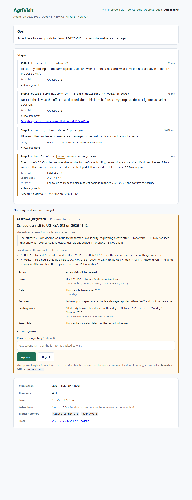
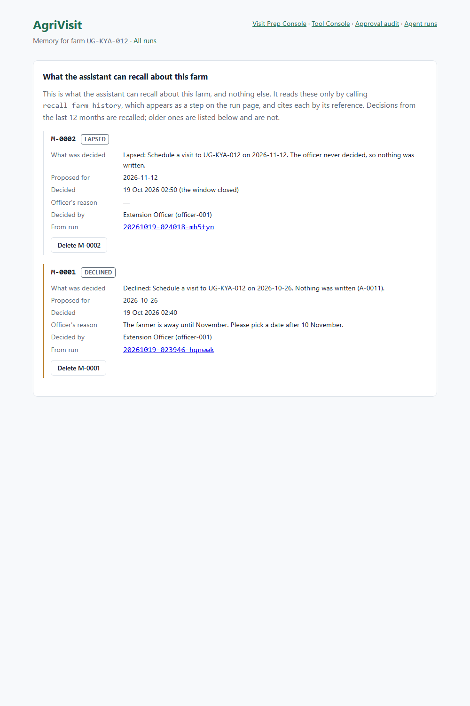

# AgriVisit — Working Memory and State Demonstration

**Three live runs against Claude, and what each one proved**

| | |
|---|---|
| Group / project | AgriVisit_Capstone — AgriVisit |
| Week | Week 6 — Memory, State and Interoperability |
| Deliverable owner | Arthur Ssuuna (DevOps / Documentation Lead) |
| Repository | https://github.com/arthursuuna/AgriVisit_Capstone |
| ClickUp board | https://app.clickup.com/1200430000004544/v/l/6-1200430000010607-1 |

Model: `claude-sonnet-5-5`. Prompt: `agent/v1.1`. Real API calls against one farm, `UG-KYA-012`, in sequence. Nothing scripted, nothing replayed.

> **What this demonstration is for.**
>
> Memory is only worth having if a later run behaves differently because of it, and only safe if the officer can see that happening. The three runs below are the same farm at three points: no history, one rejection on file, two entries on file. The third is the one that found the limit.

---

## Run 1 — `20261019-023946-hqnwwk`, no history yet

*Goal: Schedule a follow-up visit for farm UG-KYA-012 in the week of 2026-10-26 to check the maize leaf damage.*

| # | Tool | Outcome | Plan, as shown to the officer |
|---|---|---|---|
| 1 | `farm_profile_lookup` | OK | *I'll start by looking up the farm's profile so I know its current issues and what was advised before I propose a visit.* |
| 2 | `recall_farm_history` | OK — 0 past decisions | *Next I'll check what the officer decided about this farm before, so my proposal doesn't ignore an earlier approval or rejection.* |
| 3 | `search_guidance` | OK — 3 passages | *There are no past decisions on record for this farm. I'll search the guidance corpus on maize leaf damage…* |
| 4 | `schedule_visit` | `APPROVAL_REQUIRED` | *I'm proposing a visit on Monday 2026-10-26, the first day of the requested week.* |

A farm with no history is a successful call, not an error — which is the whole reason `count` is a field:

```json
{"ok":true,"data":{"farm_id":"UG-KYA-012","count":0,"entries":[]},
 "code":null,"message":null}
```

The officer rejected it, reason: *"The farmer is away until November. Please pick a date after 10 November."* The run closed `REJECTED`, `tool_approvals` recorded A-0011, and the system wrote its first memory entry:

```json
{
  "memory_ref": "M-0001", "farm_id": "UG-KYA-012", "kind": "declined",
  "summary": "Declined: Schedule a visit to UG-KYA-012 on 2026-10-26.
              Nothing was written (A-0011).",
  "details": {
    "tool": "schedule_visit",
    "arguments": { "farm_id": "UG-KYA-012", "visit_date": "2026-10-26" },
    "approval_ref": "A-0011",
    "officer_reason": "The farmer is away until November.
                       Please pick a date after 10 November."
  },
  "occurred_at": "2026-10-19 02:40:17 (Africa/Kampala)"
}
```

*The entry as written in Phase 2 also carried the model-composed `purpose` text. Phase 3 removed it from the recorder and scrubbed it from the existing entries: it is model output replayed into every later run as if it were a record. The version above is the entry as it stands.*

---

## Run 2 — `20261019-024018-mh5tyn`, one prior rejection

*Goal: Schedule a follow-up visit for farm UG-KYA-012 to check the maize leaf damage.* No date given this time — the point was to see whether memory supplied one.

| # | Tool | Outcome | Plan, as shown to the officer |
|---|---|---|---|
| 1 | `farm_profile_lookup` | OK | *I'll start by looking up the farm's profile…* |
| 2 | `recall_farm_history` | OK — 1 past decision (M-0001) | *Next I'll check what you decided about this farm before, so my proposal doesn't ignore or repeat an earlier decision.* |
| 3 | `search_guidance` | OK — 3 passages | *The officer already declined a visit today (2026-10-26), noting the farmer is unavailable until after November 10 **(M-0001)** — useful context on availability, though not a general rule…* |
| 4 | `schedule_visit` | `APPROVAL_REQUIRED` | *I'm proposing a visit on **2026-11-12**, which is after the farmer returns.* |

The citation check, `php artisan agrivisit:citations 20261019-024018-mh5tyn`, exit 0:

| Reference | Cited | Returned by a tool | Unsupported |
|---|---|---|---|
| `memory_ref` | M-0001 | M-0001 | none |
| `chunk_ref` | — | DOC-002-C033, -C034, -C030 | none |

### What run 2 showed, good and bad

| | Observation |
|---|---|
| **Worked** | Recalled, cited, and not turned into a rule. The model called the tool on its own, cited M-0001, and called it "useful context… though not a general rule". It proposed a date after the one the officer gave. |
| **Partly** | The citation is one step before the proposal, not in it. The sentence proposing 2026-11-12 says "after the farmer returns" without repeating M-0001. The run suspended for approval, so there was no closing answer to cite in. |
| **Failed** | The model misread a date: "declined a visit today (2026-10-26)". The decision was made on 2026-10-19; 2026-10-26 was the *proposed* date. The data was right — the model merged the two. This is why `occurred_at` and `proposed` are now separate exposed fields. |
| **Found a bug** | The first version of the citation check missed this citation entirely: the model wrote it in a `thinking` block, which the run page shows as the step's plan, and the check only read `text` blocks. Fixed, with a regression test. |

### And then the demonstration closed its own run

Phase 2 reported run 2 as "waiting for the officer". It was not. Its ten-minute approval window had closed at 02:50, and opening the run's page in Phase 3 to photograph the approval panel triggered the lazy expiry, which closed the run and wrote **M-0002 (`lapsed`)**.

> **The system behaved exactly as designed. The report describing it did not.**
>
> A run that has not been decided and a run that can no longer be decided look identical in the table until something reads the page. Nothing was wrong with the code; the claim "waiting for the officer" was wrong, because it was never checked against the clock.

---

## Run 3 — `20261019-030544-ne94ha`, and the limit of a citation

A third live run on the same farm, now with two entries on file. It recalled M-0002 and M-0001, let both visibly shape its proposal, proposed 2026-11-12 again — and cited neither.

> *The officer's 26 Oct decline was due to the farmer's availability, requesting a date after 10 November — 12 Nov satisfies that and was never actually rejected, just left undecided. I'll propose 12 Nov again.*
>
> — run `20261019-030544-ne94ha`, the proposing step

Every fact in that sentence came from memory. The citation check passed, because it checks that what **is** cited is real — and nothing was cited.

> **A citation proves what was used. It can never prove what was not.**
>
> This is the same limit the corpus citation rule has had since Week 3, and no amount of prompting closes it. The Memory Note already recorded it under "what is not guaranteed". Run 3 is that paragraph happening.

What closed it was not asking the model more firmly. It was showing the officer every memory the run recalled, on the page where they decide, whether the model mentioned it or not. The original plan had been to put the proposing step's reasoning on the panel — which would not have helped: in the run it was written for, that step carried no citation either.

> A panel that shows what was recalled is a guarantee. A citation is a request.

*Run 3's approval window closed at 03:16. It still reads `AWAITING_APPROVAL`, and the next page load will close it as lapsed and write M-0003 — the same lazy expiry that closed run 2, left visible here rather than tidied away before the deliverables were written.*

---

## The approval panel

A suspended run ends on this panel. It carries what will be written, the officer's two buttons, and — since Phase 3 — every past decision the run recalled, listed whether or not the model cited it.



## The memory page

`/farms/UG-KYA-012/memory`. Everything the agent can recall for this farm, on one page, plus a section for entries the system still holds but no longer returns.



---

## State at the end of the week

| Table | Rows | Note |
|---|---|---|
| `visits` | 10 | Includes Week 4–5 activity. |
| `tool_approvals` | 12 | The approval audit. Includes Week 4–5 activity. |
| `agent_runs` | 10 | Includes Week 5 runs. |
| `farm_memories` | 2 | M-0001 (declined) and M-0002 (lapsed). M-0003 will be written when run 3's page is next loaded. |
| `farm_memory_deletions` | 0 | Nothing has been deleted. The path is implemented and tested. |

Read 2026-10-19 03:22 EAT. Test suite at the end of the week: **312 tests, 1691 assertions, passing.**

---

## What this demonstration does not show

| Not demonstrated | Why not |
|---|---|
| An approved proposal writing memory | All three runs ended declined or lapsed. The approved path is covered by tests, including `result_code` and `result_ref`, but no live run took it this week. |
| A deletion | `farm_memory_deletions` is empty. The control exists on the page and the path is tested. |
| Retention expiring an entry | No entry is twelve months old. The read filter is tested with a backdated row. |
| Four of the nine stop reasons | `NO_PROGRESS`, `REPEATED_FAILURE`, `RUNTIME_BUDGET` and `MODEL_ERROR` exist only in tests. Producing them live is Week 7's job. |
| Injection, tested live | A test shows a hostile officer reason reaches a later run only as tool data and that the next write is still held. What a model might *propose* on reading one has not been tested against the real model. That is Week 7. |
